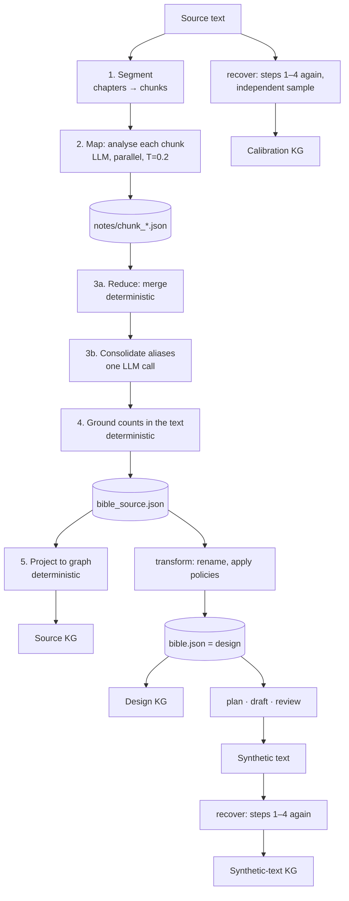

# Technical design: story bible and knowledge graph

| | |
|---|---|
| Status | Implemented (v2) |
| Code | `psalm_saga/stages/extract.py`, `psalm_saga/graph.py`, `psalm_saga/stages/transform.py`, `psalm_saga/stages/recover.py`, `psalm_saga/stages/review.py`, `psalm_saga/eval/automatic.py` |
| Data | `bible_source.json`, `bible.json`, `recovered/`, `calibration/`, `notes/chunk_*.json` |
| Related | [DESIGN.md](DESIGN.md) (clean-room boundary), [paper §3.2.2](paper/03-methodology.md), [paper §4.2 KG](paper/04-experimental-setup.md) |

## 1. Purpose

The story bible is a structured, source-free description of a story's content: who is in it,
where it happens, what happens in which order and why, and how the people and things relate.
The knowledge graph (KG) is the same information as typed nodes and edges.

It serves four purposes:

1. **Generation input.** Planning, drafting and review work from the (transformed) bible rather
   than from the source text, which is what keeps the source's wording out of the synthetic text.
2. **Fidelity check during generation.** The design checklist given to the writer and the reviewer
   is derived from it (§9).
3. **Measurement.** The same construction applied to the synthetic text gives a graph of what
   that text actually realises; comparing it with the source graph is instrument KG (§8).
4. **Inspection.** Researchers can explore, compare and export it (web app, GraphML).

## 2. Requirements

| # | Requirement | How it is met |
|---|---|---|
| R1 | Any language, any length (up to novels of 100k+ words) | Map-reduce over chunks; no call sees the whole text; prompts ask for output in the passage's language |
| R2 | No source wording in the representation | Descriptions in the model's own words; quotes limited to a few words; style notes are dropped at the transform step |
| R3 | Comparable across texts | One construction procedure for source and synthetic text; graph projection is deterministic code |
| R4 | Measurement, not generation | Analysis calls run at temperature 0.2; counts are computed from the text, not taken from the model |
| R5 | Inspectable and editable | Every intermediate is a JSON file; the bible can be edited (web app or instruction) before planning |
| R6 | Resumable | Each chunk's notes are stored; a resumed run skips finished chunks |
| R7 | Honest about its own noise | A second, independent analysis of the source gives a ceiling for every graph comparison (§7.4) |

## 3. Overview

Two layers: a **model-built bible** (steps 1–4) and a **deterministic graph projection** (step 5).
Only the first layer involves a language model.

## 4. Data model

Defined in `psalm_saga/artifacts.py` (Pydantic).

### 4.1 Map output: `ChunkNotes` (one per chunk)

| Field | Type | Content |
|---|---|---|
| `summary` | str | What happens, in order, 3–8 sentences |
| `scenes` | `SceneNote[]` | One per change of time, place or participants: `summary`, `setting`, `characters[]`, `purpose`, `pov`, `location` (name of a place entity) |
| `entities` | `EntityNote[]` | `name`, `kind` ∈ {character, place, object, organisation, other}, `aliases[]`, `description`, `role`, `gender` ∈ {female, male, nonbinary, unknown} |
| `relations` | `RelationNote[]` | `source`, `target` (entity names), `type` (short lowercase verb phrase), `description` |
| `events` | `EventNote[]` | `description`, `characters[]`, `caused_by` (text), `cause_index` (0-based index of an earlier event in this chunk, or null), `location` |
| `style` | str | Observations on form and narration |

### 4.2 Reduced output: `Bible`

| Field | Type | Content |
|---|---|---|
| `entities` | `Entity[]` | `id` (`e1`, `e2`, …), `name`, `kind`, `aliases[]`, `description`, `role`, `gender`, `chapters[]`, `mentions` |
| `relations` | `Relation[]` | `source`, `target` (entity **ids**), `type`, `description` |
| `chapters` | `ChapterSummary[]` | `index`, `title`, `summary`, `word_count`, `scenes[]`, `events[]` (the chapter *skeleton*) |
| `style_notes` | str[] | Up to 8 sampled chunk style notes (source only; emptied by transform) |

### 4.3 Files

| File | Written by | Meaning |
|---|---|---|
| `notes/chunk_NNN.json` | extract | Map output per chunk (resume point) |
| `bible_source.json` | extract | Bible of the source |
| `bible.json` | transform | The design: the source bible renamed and transformed under the policy |
| `recovered/bible_source.json` | recover | Bible re-extracted from the synthetic text |
| `calibration/bible_source.json` | recover | Second, independent bible of the source |
| `graph-*.graphml` | export | Graph exports (Gephi, yEd, Cytoscape, networkx) |

## 5. Construction of the bible

### 5.1 Segmentation (`text/chunking.py`)

1. **Chapters.** Heading lines standing on their own (markdown `#`, "Chapter/Hoofdstuk/Kapitel … N",
   Roman numerals, "12." with optional title). Runs of headings with almost no body (a table of
   contents) are skipped; a heading with a tiny body is folded into the previous chapter.
2. **Fallbacks.** A verse collection with at least three titled poems becomes one chapter per
   poem. Otherwise the text is cut into pseudo-chapters of about `pseudo_chapter_words` (5,000) at
   paragraph boundaries (a text up to 1.3× that size stays one chapter).
3. **Chunks.** A chapter up to 1.25 × `chunk_words` (4,000) is one chunk; longer chapters are
   packed paragraph by paragraph into chunks of about `chunk_words`. Each chunk knows its chapter,
   chapter title and part number.

### 5.2 Map: chunk analysis (`prompts/extract_chunk.md`)

One structured call per chunk, in parallel (`parallel`, default 8), temperature 0.2, output
validated against `ChunkNotes` (invalid JSON gets a repair round-trip). The prompt asks for what a
literary scholar would need to reconstruct the story's structure without the text, in the
passage's language, in the model's own words, supported by the passage only.

Chunks are analysed **independently**. The prompt has a slot for names known from earlier chunks,
but it is left empty so that all chunks can run in parallel; name drift between chunks is resolved
in 5.3–5.4.

### 5.3 Reduce: deterministic merge (`Extract._merge`)

- **Entities.** Names and aliases are normalised (lower case, collapsed whitespace). An entity
  note joins an existing entity when *any* of its names or aliases matches a known name or alias;
  otherwise it gets a new id. Merging accumulates aliases, appends new description text (up to
  ~900 characters), keeps the first role and the first known gender, and records the chunk's
  chapter.
- **Relations.** Both ends are resolved through the alias table. A relation is kept only if both
  resolve to two different entities, and is deduplicated on (source, target, lower-cased type).
  Different verbs for the same pair ("owns", "possesses") are kept as separate relations.
- **Chapter skeletons.** Scenes and events are concatenated per chapter in chunk order.
  Chunk-local `cause_index` values are offset to chapter-level positions; an index that does not
  point backwards is dropped. Chapter summaries are the chunk summaries joined.
- **Style notes.** At most 8, evenly sampled.

### 5.4 Consolidation (`prompts/consolidate_entities.md`)

One structured call over the full entity list (id, kind, name, aliases, first 240 characters of the
description). The model groups entries that clearly denote the same entity ("Hale", "the captain",
"Captain Hale"), picks a canonical name and writes one description and role. Instructions: merge
only on clear evidence; people sharing a surname stay separate; every id in exactly one group.
Entities the model omits are kept unchanged. Relations are re-pointed to the surviving ids and
deduplicated again.

### 5.5 Grounding in the text

`chapters` and `mentions` of every entity are recomputed from the source by whole-word,
case-sensitive matching of the name and aliases per chapter. Entities are then sorted by mentions.
These counts — not the model's — decide graph node weight, which characters count as "main" in
the evaluation, and which places and objects belong to a chapter.

## 6. Graph projection (`graph.build_graph`)

Deterministic and stateless: the same bible always gives the same graph.

### 6.1 Nodes

| Type | Id | One per | Weight |
|---|---|---|---|
| character, place, object, organisation, other | entity id | entity | mentions |
| chapter | `ch<n>` | chapter | word count |
| scene | `s<chapter>.<i>` | scene in the skeleton | 1 |
| event | `v<chapter>.<i>` | event in the skeleton | 1 |

Each node carries `chapters` (for filtering) and `details` (description, aliases, role, summary,
setting, cause text, and in comparisons the counterpart's name).

### 6.2 Name resolution

Scenes and events refer to people and places by name, as written. A resolver maps such a name to an
entity id by (1) exact normalised name or alias, else (2) a capitalised word of more than two
letters that belongs to exactly one entity ("Ballmer" → George Ballmer). For places it can also
search a scene's setting and summary text for a place name.

### 6.3 Edges

| Type | From → to | Rule |
|---|---|---|
| `relation` | entity → entity | One per bible relation, labelled with its verb phrase; group `social` if both ends are characters, else `world` |
| `appears_in` | entity → scene | Each resolved name in the scene's character list |
| `set_in` | scene → place | The scene's named location, else the first place name found in its setting/summary |
| `involves` | event → character | Each resolved name in the event's character list |
| `happens_at` | event → place | The event's named location |
| `causes` | event → event | **Explicit**: the event's `cause_index` points at an earlier event in the chapter. **Inferred** (`inferred: true`): the cause was given only as text; it links to the earlier event (any earlier chapter) with the highest content-word Jaccard overlap, if ≥ 0.25 (at most `max_cause_links`, default 1) |
| `co_occurs` | character ↔ character | Undirected; weight = scenes shared (or chapters shared, if no scene lists its cast) |
| `in_chapter` | scene/event → chapter | Position |
| `next` | scene → scene, chapter → chapter | Reading order |

Repeated edges (same type, ends and label) are merged by adding weights and uniting chapters.
Content words exclude a short stop list (English, Dutch, German articles and prepositions) and
tokens of two letters or fewer.

## 7. Graph variants

### 7.1 Source graph
`build_graph(bible_source.json)`.

### 7.2 Design graph (`transform`)
1. **Renames.** A rename table (`transform.json`) maps every proper name to a new one. It is applied
   to the whole bible, including inside descriptions, summaries and compound names
   ("George's chest" → "Nathaniel's chest"). Ids stay the same, so design and source align by id.
2. **Policies.** Under `abstract` or `regenerate`, character and world descriptions are rewritten,
   and each chapter skeleton is re-told under the transformed spec (the scene count must stay the
   same, otherwise the renamed skeleton is kept). Under `preserve` the design is the renamed source.
3. Style notes are removed (the spec carries style).

The result, `bible.json`, is what the writer works from. With everything preserved, "source vs
design" shows no structural changes by construction.

### 7.3 Synthetic-text graph and its alignment with the design (`recover`)
Steps 1–4 run once on the finished synthetic text, with the same extractor, prompts and settings,
into `recovered/`. The source is **not** analysed again: its graph exists, and the design keeps the
source's ids. Instead, the synthetic text's graph is **aligned with the design** — both use the
names the writer was given — in four steps (`eval/kg_align.py`, stored in `recovered/alignment.json`):

1. **Rules.** `compare_graphs(design, text)` in the shared name space (§8): names, aliases,
   inflection-aware content words, ties to already paired neighbours; scenes and events by content.
2. **Model: entities.** The design's characters, places, objects and organisations the rules left
   unpaired, and the text's, are listed with kind, names, chapters and description; one call pairs
   those that denote the same entity (a role for a name, a nickname, another classification),
   one-to-one, with a confidence and a reason. Low-confidence pairs are dropped.
3. **Model: story.** Per chapter, the unpaired design scenes (then events) and the text's, each in
   story order, are paired by what happens and who takes part; one design item may take two
   consecutive text items (told in two parts).
4. **Check the text.** Design items still unmatched — events, scenes, characters, places, objects,
   relations, causes — are checked against the synthetic chapter itself: per chapter, one call
   receives the chapter and the list (at most 40 items) and answers *yes / partly / no* per item,
   quoting at most 20 words as evidence. An item found this way was realised but missed by the
   analysis; it counts as kept (*partly*: changed), and the evidence is shown.

Because design ids are source ids (for entities and scenes always; for events when the policy kept
the chapter's number of events), the same alignment says for every **source** item whether the
synthetic text kept, changed or lost it (`text_comparison(store, "source")`). With
`stages.recover.params.align=rules` only step 1 runs; `check_text=false` skips step 4.

### 7.4 Calibration graph (optional: `recover`, `calibrate=true`)
Off by default. Steps 1–4 of §5 run a second time on the source, as an independent sample.
Comparing the source graph with it shows how far the extractor agrees with itself on identical text
— a noise ceiling for experiments; when present, KG recall is also reported relative to it.

## 8. Comparison (`graph.compare_graphs`)

Input: a source graph, a second graph, and the rename table. Output: one merged graph in source
coordinates, every node and edge marked `kept`, `changed`, `source_only` or `synthetic_only`, with
a `diff` note, plus per-type recall and precision.

### 8.1 Entity alignment (in order, each synthetic node used once)

1. **By name.** Each source entity's names are translated through the rename table, as whole names
   and inside names, and looked up among the other graph's names and aliases.
2. **By content words.** Same words, ignoring articles, possessives, numerals, case and order ("the
   chest of Nathaniel" ~ "Nathaniel's chest", "de twee snorren" ~ "De snorren").
3. **Without the owner.** For non-characters: the name with character names removed, including the
   Dutch/German s-genitive without apostrophe ("Roberts paraplu" ~ "de paraplu"), if exactly one
   candidate remains.
4. **By id**, when both graphs share ids and the names agree (design comparisons).
5. **Scored second pass** for what is left, greedy, best score first:
   `score = name + 0.5 · description + 0.25 · shared_aligned_neighbour + 0.3 · same_relation_to_aligned_neighbour + 0.2 · chapter_overlap − 0.1 · kind_differs`,
   where `name` is the best word overlap over all pairs of names (so an alias cannot dilute it) and
   words match up to inflection: equal, equal after removing a plural or diminutive ending
   (`-en, -s, -es, -e, -n, -er, -je, -tje, -jes, -tjes`, with a doubled final consonant undone:
   "stok"/"stokken", "paard"/"paardje"), or sharing a start that covers at least 70% of the longer
   word ("marsepein"/"marsepeinen") — but not a shorter stem of a compound ("trommel" ≠
   "trommelstok"). Accepted at ≥ 0.55 with some name overlap, the same relation to the same
   aligned neighbour, or a shared neighbour plus description overlap ≥ 0.3. Characters and places
   must keep their kind; objects, organisations and "other" may be classified differently.

### 8.2 Story-node alignment
Chapters align by number. Scenes and events align **within each chapter by content**, with an
order-preserving sequence alignment (dynamic programming) that maximises the summed similarity
`0.65 · word_overlap(what happens, after renaming) + 0.35 · overlap(aligned participants and places)`
over pairs above 0.12; items may stay unpaired. A synthetic item left unpaired directly next to a
paired one and similar to its source item (≥ 0.2) is treated as the second part of a split scene:
it is absorbed into that item instead of being reported as new. This replaces pairing by position,
under which one split scene shifted every later scene of the chapter to "changed".

### 8.3 What counts as a change
- A scene or event is `changed` only when **most of its cast** differs (character overlap < 0.5).
  A minor figure more or less, a differently worded place, or "told in two parts" is shown as a
  remark in brackets, not as a change.
- An entity is `changed` when a person became a place (or vice versa), or when a **proper name**
  appears in clearly different chapters. A different classification of objects/organisations, or a
  chapter shift of a descriptive entity ("de moeder", whose mentions are counted literally and
  match any mother), is a remark.
- Edges match on (type, group, aligned source, aligned target); relations also match reversed.
  A relation matched in the reversed direction with another label ("mother of" / "daughter of") is
  the same tie stated from the other side: kept, with a remark. A same-direction relation with a
  different label (unless they overlap: one contains the other, or word Jaccard ≥ 0.5) is `changed`.

For the synthetic text, `compare_graphs` is called with the alignment of §7.3 (`prealign`: pairs
that take precedence over the rules; `checks`: items confirmed in the text). When the optional
calibration exists, the comparison also carries the **ceiling** (§7.4).

### 8.4 Scores (instrument KG, `eval/automatic.kg_scores`)
For characters, places, events, causal links and social relations:
`recall = (kept + changed) / (kept + changed + source_only)`, and, when the calibration graph exists,
`relative = min(1, recall / ceiling)` where `ceiling` is the same recall of the calibration graph
against the source. The relative value is graded. A measure whose ceiling is 0 (the source analysed
twice does not find those items again) is reported as not measurable on that text.

## 9. Consumers

| Consumer | Uses |
|---|---|
| `plan` | Whole design bible (entities and relations, top 40 by mentions) as context; each chapter's skeleton (scenes, events, causes); skeleton word counts as chapter budgets |
| `draft` | The chapter's cast: characters in its scenes plus up to 8 places/objects belonging to it, with the relations among them; the **design checklist** as "facts this chapter must show" |
| `review` | The chapter's cast; the design checklist, each item marked realised / missing / contradicted. Missing or contradicted items become issues (event or cause missing → major, contradicted → blocker; relations and world items → minor unless contradicted); items the plan omitted are routed to re-planning |
| `evaluate` | Instrument KG (§8.4); character measures use the bible's names and aliases |
| Web app | Bible tab: graph views (source, design, synthetic text, comparisons, source vs its second analysis), filter by chapter, node and edge details |
| Export | `saga graph RUN [--compare design|text]`, `GET /api/runs/{id}/graph?which=…&against=…&format=graphml` |

**Design checklist** (`review.design_checklist`, max 30 items per chapter): `E` events of the
chapter skeleton, `C` causal links ("X — because: Y"), `R` relations whose both ends are in the
chapter (max 10), `W` places and objects of the chapter by mentions (max 6).

## 10. Configuration

| Key | Default | Effect |
|---|---|---|
| `stages.extract.params.chunk_words` | 4000 | Chunk size for the map step |
| `stages.extract.params.pseudo_chapter_words` | 5000 | Chapter size when the text has no headings |
| `stages.extract.params.parallel` | 8 | Concurrent chunk analyses |
| `stages.extract.params.temperature` | 0.2 | Analysis temperature |
| `stages.extract.params.consolidate` | true | Alias consolidation call |
| `stages.recover.params.calibrate` | true | Second analysis of the source (ceiling) |
| `stages.review.params.coverage` | true | Design checklist in review |
| `stages.transform.params.max_entities` | 120 | Entities sent for renaming/rewriting |
| `models.extract.*` | default model | Model used for analysis (and therefore for recover/calibration) |

## 11. Interfaces

- **SDK:** `run.graph(which="source"|"synthetic"|"recovered"|"compare", against="design"|"text"|"calibration")`,
  `run.recovered_bible()`, `await run.arecover()`.
- **CLI:** `saga graph RUN [-f graphml|json] [--compare design|text]`, `saga show RUN bible`,
  `saga edit RUN bible "…"`.
- **REST:** `GET /api/runs/{id}/graph`, `POST /api/runs/{id}/recover`, artifacts under
  `/api/runs/{id}/artifact/{name}`.

## 12. Limitations and failure modes

| Issue | Effect | Mitigation today |
|---|---|---|
| Chunks do not share names | The same entity under different names across chunks | Alias merge + consolidation call |
| Relation ends must resolve to known names | Relations written with an unknown name form are dropped; relationship counts are small and unstable | Calibration ceiling; "not measurable" when the ceiling is 0 |
| Consolidation is one call over all entities | On very long texts, a long list; merges depend on one answer | Entities the model omits are kept as they are |
| Inferred causes use word overlap | A cause can be linked to the wrong earlier event, or not at all | Explicit `cause_index` within a chunk takes precedence; marked `inferred` |
| Mention counting is literal and case-sensitive | Inflected or lower-case forms are missed; a full name and its first name both count on one occurrence | Used for weights and thresholds; chapter shifts of descriptive entities are remarks only |
| Inflection rules are for Dutch, English, German | Other languages pair fewer inflected names | Add the language's plural/diminutive endings to `_SUFFIXES` |
| Scene/event alignment is heuristic | Two analyses that split a chapter very differently can leave items unpaired | Content-based sequence alignment with split absorption; ceiling shown alongside |
| Two analyses never agree fully | Raw recall understates fidelity | Relative scores against the calibration ceiling |

## 13. Possible extensions

- Pass known canonical names forward between chunks (sequential within a chapter, parallel across
  chapters) to reduce name drift.
- Normalise relation verbs to a small vocabulary (kinship, employment, ownership, location, …) so
  that relation matching does not depend on wording.
- Use embeddings for scene/event similarity instead of word overlap.
- Lemmatised, case-insensitive mention counting per language.
- Cross-chunk explicit causes (pass the previous chunk's events as indexable context).

## 14. Tests

`tests/test_graph.py` (projection, comparison, owner-named objects, API), `tests/test_calibration.py`
(ceiling and relative scores), `tests/test_trace_and_coverage.py` (design checklist and coverage
routing), `tests/test_measure_floors.py` (not-measurable cases).
